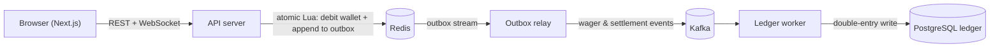

# CallIt

**Live prediction games for watch parties.** A host asks a question
mid-stream ("Will they score this drive?"), everyone in the room bets
virtual tokens in a few seconds, the odds move in real time as bets land,
and payouts settle the moment the host calls the result.

Underneath the game sits a real-money-grade backend: a ledger that
cannot double-spend, an event pipeline that survives crashes without losing
a wager, and a production deployment with TLS and vaulted secrets.


---

## Highlights

| | |
|---|---|
| **0 double-spends** | 5,983 wagers under load reconciled exactly between Redis wallets and the PostgreSQL double-entry ledger |
| **1 ms** | p99 WebSocket broadcast latency for live odds updates |
| **2.73 ms** | average server-side bet placement, down from 4.76 ms by cutting five Redis round trips to two |
| **~3,200 req/s** | sustained REST throughput on one instance; the k6 load generator ran out of headroom before the server did |
| **Chaos tested** | killed the relay, ledger worker and Kafka broker mid-load on Kubernetes; every wager still reached the ledger exactly once |
| **88.8% coverage** | 300+ Go tests run against real Redis, PostgreSQL and Kafka in CI with the race detector on; pure domain logic at 100% |
| **In production** | deployed at `callit.duckdns.org` behind Caddy with automatic TLS; secrets come from 1Password and never touch disk |

## How it works



The hot path stays in memory so bets feel instant, while every token is
still accounted for durably:

1. **Bets are atomic.** A single Redis Lua script checks the balance,
   debits the wallet, updates the pool and appends an event to an outbox
   stream, all at once. Two concurrent bets can't both spend the same
   tokens.
2. **The API never writes to the database.** A separate relay moves outbox
   events to Kafka, and a ledger worker writes them to PostgreSQL as
   balanced double-entry transactions. If any process crashes between
   steps, the outbox still holds the event and delivery resumes.
3. **Odds are pari-mutuel.** Everyone who picks the winning side splits
   the pool in proportion to their stake. Integer rounding "dust" is
   tracked explicitly, so the books always balance to the token.
4. **Fair-play rules live on the server.** Hosts can't bet on their own
   rounds, individual bets stay anonymous until resolution, betting
   locks on the server clock rather than the client's, and one rate
   limiter guards every endpoint.

## Engineering decisions worth a look

- **A transactional outbox instead of dual writes.** Writing to Redis and
  then PostgreSQL leaves a crash window where a wallet is debited but the
  ledger never hears about it. The outbox closes that window.
  [Design spec →](docs/specs/2026-08-21-callit-design.md)
- **Chaos testing caught a real bug.** On the first Kubernetes chaos runs,
  a relay crash during a Kafka outage lost 25 wagers, because events claimed
  by a dead consumer were never reclaimed. After the fix, the run loses zero,
  and that fix is now in production (`v0.3.1`).
  [Kubernetes & chaos →](deploy/k8s/README.md)
- **I report load-test results as measured.** The p99 bet latency lands
  exactly on the 15 ms bucket boundary, so the report marks it
  *inconclusive* rather than *met*. The throughput ceiling was traced to the
  load generator, not the server.
  [Load-test report →](docs/reports/2026-08-31-phase-7b-baseline.md)
- **Security review at the end of every phase.** argon2id passwords with
  constant-time responses (unknown email and wrong password are
  indistinguishable, even by timing), HS256-pinned JWTs, a CORS allowlist
  that rejects `*`, and secrets mounted only into the containers that need
  them. CI fails if a secret ever lands in a container environment variable.
  [Findings by phase →](docs/project-history.md)
- **Built in planned phases.** Over 500 commits across 10+ phases, each
  with a written plan, test-first checkpoint commits, and a dated journal.
  [Implementation plan →](docs/plans/2026-08-21-implementation-plan.md)

## Tech stack

| Layer | Technology |
|---|---|
| Backend | Go: `net/http`, WebSockets, a goroutine per room, server-side round timers |
| Real-time state | Redis with Lua scripts for atomic wallet, pool and round transitions |
| Event pipeline | Kafka, using the transactional outbox pattern |
| Ledger | PostgreSQL double-entry bookkeeping, versioned SQL migrations |
| Frontend | Next.js (App Router), React, TypeScript strict, Tailwind |
| Testing | Go race detector, integration tests on real services, Vitest, Playwright, k6 |
| Infrastructure | Docker Compose, Kubernetes (kind), Caddy, systemd, 1Password Service Accounts, GitHub Actions |

## Run it locally

Requires Go, Node.js and Docker.

```bash
make up-full && make migrate                               # Redis, PostgreSQL, Kafka + schema
JWT_SECRET=$(openssl rand -hex 32) go run ./backend/cmd/api # API on :8080
make relay & make ledger-worker &                           # outbox → Kafka → ledger
make fe-install && make fe-dev                              # UI on http://localhost:3000
```

Run the tests with `make test` (backend, starts its own stack) and
`make fe-test` (frontend).

Configuration, the full repository layout, load testing and operations are
in the **[development guide](docs/development.md)**. Production deployment
is in [`deploy/README.md`](deploy/README.md).

## Repository map

```
backend/    Go services: api, relay, ledger-worker, migrate, plus a CLI client
frontend/   Next.js app and Playwright end-to-end tests
deploy/     Compose production stack, Kubernetes manifests, chaos test, secrets tooling
loadtest/   k6 scenarios
docs/       design spec, phase plans, load-test reports, project history
journal/    dated engineering log
```

---

Built by **Ansh** · [GitHub @zorojuro12](https://github.com/zorojuro12)
